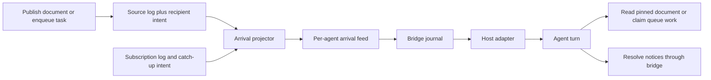

# Arrival notifications and agent activation

Date: 2026-10-21. Status: implementation in progress. Source baseline: `edcbc923`.
Progress and qualification: [implementation record](../impl/arrivals-20261021/README.md).

## Decision

Add durable subscriptions for document and queue arrivals, a separate arrival
feed for each agent identity, and a local host bridge that schedules a turn in
the intended agent session. Persist notification recipients in the original
resource event so a crash cannot leave a successful publication without a
recoverable notice.

The first host adapter should manage a Codex App Server session. Add a managed
Claude adapter next. An optional Claude Channels adapter can notify an
explicitly opted-in interactive session, with the same durable feed beneath it.

The delivery contract is **at least once**. Source commit, durable notice,
bridge receipt, agent observation, and task completion are separate states.
A notification never grants a task lease or establishes exactly-once effects.

## Existing behavior

- Documents and queue events commit to their own logs. Their current mutation
  paths do not create arrival notices: [documents](../../src/docs.rs#L639),
  [enqueue](../../src/queues.rs#L798).
- Direct messages already have a long-poll and explicit acknowledgment:
  [wait](../../src/messaging.rs#L415), [ack](../../src/messaging.rs#L497).
  The shared inbox cursor makes it unsuitable for a background consumer that
  must coexist with the agent's existing message-reading behavior.
- The current MCP surface exposes tools and emits no arrival notifications:
  [HTTP implementation](../../src/mcp.rs#L710). Installing it alone does not
  create a listener or start model turns.
- Agent identity belongs to one session, independently of its kind and display
  label. Follow [CONTEXT.md](../../CONTEXT.md). Credential reuse through
  `mcp-stdio --resume` does not itself resume a model conversation.

## Scope and vocabulary

V1 covers exact document names and exact queue names. It handles new document
versions, enqueued tasks, requeued tasks, and a bounded current-state catch-up
when a subscription is created. Source payloads remain in their existing logs.
Host permission prompts retain the host's existing approval policy.

| Term | Meaning |
|---|---|
| Subscription | An agent identity's durable request for events from one named resource. |
| Source event | A committed document, queue, or subscription record containing notification intent. |
| Arrival notice | A durable reference to an event, addressed to one agent identity. |
| Arrival feed | That identity's ordered notice stream, with its own acknowledgment cursor. |
| Binding | The bridge's explicit association between a broker identity and one host session. |
| Wake | A request to give a bound session a turn in which it can handle pending notices. |
| Resolution | The agent's recorded disposition of notices supplied in a wake. |

A queue notice means work may be available. `claim_task(queue)` still selects
the oldest ready task; an advisory task ID in a notice does not select or reserve
that task. A document notice pins a version, so later updates do not change its
reference.

## Architecture and module ownership



| Module | Interface and ownership |
|---|---|
| `ArrivalService` | Subscribe, unsubscribe, list, wait, acknowledge. Own subscription replay, projection, feed durability and dedupe. |
| Document and queue modules | Capture routes at the source commit and announce a new committed head. Their existing logs remain authoritative. |
| `HostBridge` | Receive notices durably, own one session binding, coalesce wakes, retry uncertain handoffs, record resolutions. |
| Host adapter | Report capabilities and session state; submit a wake to the exact bound session and reconcile uncertain submissions. |

The broker has no dependency on a model provider. Host adapters never append
broker files directly. The projector uses committed source heads; complete
JSON lines awaiting a successful sync are not eligible source events.

## Subscription and broker interface

All methods authenticate the caller. Subscription ownership and feed access
use the caller's immutable `agent_id`; there is no display-name wildcard or
cross-agent acknowledgment operation.

| Proposed MCP tool | Parameters | Result |
|---|---|---|
| `coop_subscribe_arrivals` | `client_key`, `resource`, `event_kinds`, `catch_up=true` | Subscription ID, captured source boundary and any initial notice intent. |
| `coop_unsubscribe_arrivals` | `subscription_id` | Durable removal, idempotent on retry. |
| `coop_list_arrival_subscriptions` | None | The caller's subscriptions and active/removed state. |
| `coop_wait_arrivals` | `cursor?`, `timeout_s=30`, `limit=64` | Notice batch, next cursor, durable acknowledged cursor, timeout flag. |
| `coop_ack_arrivals` | `cursor` | Durable, monotonic acknowledgment through an existing feed sequence. |

Native UDS method names omit the `coop_` prefix. These are proposed additions,
not tools exposed by the current executable.

Example subscription arguments:

```json
{
  "client_key": "reviewer-reviews-v1",
  "resource": {"type": "queue", "name": "reviews"},
  "event_kinds": ["queue.task_available"],
  "catch_up": true
}
```

Document subscriptions support `doc.published` and `doc.updated`. Queue
subscriptions support `queue.task_available`, produced on enqueue and every
durable requeue, including lease expiry. Names use existing resource-name
validation. A subscription may name a resource that does not exist yet.

`client_key` is scoped to the agent identity and retained after removal. A retry
with identical arguments returns the original subscription receipt without
another catch-up; different arguments under that key return `CONFLICT`.
Resubscribing after removal uses a new key and subscription ID.

Subscription creation/removal and resource route capture share the existing
`send_lock`. No feed append or host call occurs while that lock is held:

1. Create: capture the current resource boundary and at most one catch-up
   reference, append and sync `subscription_created`, then expose it to future
   route matching.
2. Publish/enqueue/requeue: capture the active matching subscriptions and
   recipient IDs, then append them in the same source record as the change.
3. Remove: append and sync `subscription_removed`, then exclude it from future
   captures. Already committed notices remain due.

Catch-up is bounded to one resource per subscription. For documents it pins the
current head version. For a queue with ready work it produces one availability
hint with a ready-count and source boundary, rather than a list of every task.
The create record contains that snapshot intent, so a crash before its
materialization is recoverable. `catch_up=false` requests future events only.

## Durable source intent and notice identity

Extend document and queue records with an optional field:

```json
{
  "notification_intent": {
    "v": 1,
    "routes": [
      {"agent_id": "<canonical-agent-id>", "subscription_ids": ["<subscription-id>"]}
    ]
  }
}
```

The enclosing record supplies resource, event kind, sequence, and payload.
Resolve and sort routes before append; persist each recipient once, retaining
the matching subscription IDs. Never recalculate recipients from current
subscriptions during replay. Changes to aliases, credentials or subscriptions
cannot change a committed route.

The new field must use `serde(default, skip_serializing_if = "Option::is_none")`.
Historical records without it must serialize exactly as before when computing
their hash. With no matching subscriptions, omit the field entirely.

Persist a stable `bus_id` in `notifications/meta.json`. Define IDs using SHA-256
over a versioned, unambiguous canonical tuple encoding:

```text
obligation_id = H("obligation/v1", bus_id, journal_type, journal_name,
                  seq, record_hash, item_index)
delivery_id   = H("arrival/v1", obligation_id, recipient_agent_id)
```

Compute the obligation ID from the completed record; do not embed its own hash
in that record. Every arrival persists two coordinates: its obligation's
journal/sequence/hash/index and its referenced resource boundary. They are the
same for a live resource event, with `item_index=0`. Catch-up instead uses the
subscription-create journal record and snapshot index as its obligation, while
referencing the captured document/queue boundary separately. This lets a new
subscription request current state after an earlier subscription was acknowledged.

An illustrative feed record is:

```json
{
  "v": 1,
  "seq": 42,
  "prev_hash": "sha256:<previous-arrival-record-hash>",
  "delivery_id": "sha256:<stable-delivery-id>",
  "recipient_agent_id": "<canonical-agent-id>",
  "kind": "doc.updated",
  "obligation": {
    "id": "sha256:<obligation-id>",
    "journal_type": "document",
    "journal_name": "architecture",
    "seq": 17,
    "hash": "sha256:<source-record-hash>",
    "item_index": 0
  },
  "source": {
    "stream": "document",
    "name": "architecture",
    "seq": 17,
    "hash": "sha256:<source-record-hash>"
  },
  "resource": {"type": "document", "name": "architecture", "version": 3},
  "subscription_ids": ["<subscription-id>"]
}
```

Queue notices contain `queue`, a source boundary, cause (`enqueued`, `requeued`
or `current`), and an optional advisory task ID. Notices contain references,
not document bodies, task instructions or credentials. The broker alone
creates records in this feed; ordinary direct messages cannot impersonate it.

## Commit, projection and acknowledgment

Source success means **the resource change and its routing intent are durable**.
It does not mean the target is online or a model turn has started. An optional
receipt field can report `notification_state: "intent_recorded"`; recipient
unavailability must not turn an already committed source operation into an
error.

The projector appends notices under independent per-recipient file ownership,
syncs them, then publishes feed heads and wakes pending `wait_arrivals` calls.
Different recipients can progress independently. Source write/sync failures
retain the existing quarantine-until-reopen behavior. A validated uncertain
source prefix may become committed during recovery and then produce notices.

Storage additions:

```text
notifications/meta.json                 stable bus identity and feature version
notifications/subscriptions.jsonl       subscription changes and catch-up intent
agents/<agent_id>/arrivals.jsonl        notices, ordered independently of messages
agents/<agent_id>/arrivals-acks.jsonl   durable acknowledged-through records
```

V1 retains source history, feed history, subscription tombstones and ACK history.
There is no required projection-completion journal. Restart reconstructs due
routes from validated source intent and dedupe information from arrival feeds.
An advisory scan checkpoint cannot authorize deletion or suppress a required
delivery.

Process each source stream in order for each recipient. A full or failed feed
must not allow a later event from that source to bypass an earlier due notice
for that recipient. This permits compact replay-derived source watermarks
instead of an in-memory set of every historical delivery ID. A watermark is
published only after its covering feed sync. Uncertain feed writes quarantine
that feed until reconstruction; recovery discovers an already written notice
before retrying it. Replay advances watermarks using **obligation coordinates**.
Catch-up advances a subscription-log watermark, never the document/queue
watermark referenced by its snapshot; otherwise a snapshot of document seq 100
could incorrectly suppress due live events below seq 100. Catch-up obligations
follow subscription-log order and snapshot index.

Retain the existing root lease through every recovery operation and background
append. Shutdown stops admission, cancels scans, joins active writers, and only
then releases ownership. Creating a journal or directory includes syncing the
necessary parent entries before reporting a durable append or acknowledgment.

Implement bounded source scanning and feed-page reads, reusing storage sequence,
hash, recovery and rotation rules. Reading an active file must stop at its
known committed head. Feed replay must not add another full historical payload
copy to the daemon's resident state. Existing document/queue runtime memory
costs remain a separate performance concern.

`wait_arrivals` is a peek. `ack_arrivals` rejects a cursor beyond the committed
feed head, durably appends the new acknowledged position, and only then returns
success. Repeated/lower acknowledgments succeed without moving backward. An
uncertain ACK write requires recovery before further ACK mutations. Notices
remain readable by explicit historical cursor in V1.

No TTL silently deletes an arrival. Retiring an identity explicitly terminates
its subscription/delivery obligations; the persisted retirement is the terminal
disposition. An offline live identity keeps its obligations. Rotation of its
credential preserves identity. A new agent instance never inherits an old
instance's subscriptions or notices merely by sharing a label.

## Host bridge and session binding

The bridge is an ordinary authenticated broker client. Its journal lives
outside the broker's single-writer root, in a canonical private state directory
derived from `(bus_id, agent_id)`. A fixed OS lock there enforces one conforming
local bridge owner; an active lock inode is never removed/recreated. V1 does
not provide distributed bridge ownership.

A binding records:

```text
binding_id, generation, bus_id, agent_id, adapter_kind,
exact_host_session_id, workspace, capability_status
```

Managed startup enrolls one instance and shares that credential with its MCP
adapter and bridge. Restart resumes that same binding and identity explicitly.
Launching another independent session creates another identity. An attach
operation needs explicit control of the selected host session and a verified
identity/session association; matching a display name or choosing the most
recent conversation is insufficient.

The bridge is the sole arrival-feed consumer in managed mode. It hides broker
arrival wait/ACK tools from the model and exposes its resolution tool instead.
Standalone manual consumption uses the broker tools without a concurrent
bridge. Existing direct-message consumers retain their original inbox.

### Durable receive and wake scheduling

1. Wait from the bridge's durable received cursor.
2. Persist the full received notice batch and pending resolutions in its local
   journal, with covering sync. Only then acknowledge that batch to the broker.
3. Coalesce pending notices into one bounded wake for the exact binding and
   generation. Persist the wake before submitting it to the host.
4. If idle, submit a turn. If busy or awaiting permission, keep it pending and
   queue one later turn. V1 does not interrupt or steer an active turn by
   default. New arrivals received while busy are still journaled and ACKed.
5. Record host submission responses and any runtime turn IDs. A transport write
   or ambiguous timeout does not resolve the notices.
6. The agent handles supplied references and resolves them through the bridge.

The wake contains `wake_id`, binding generation and structured notice
references. It does not ask the model to read from the broker's default cursor:
the bridge may already have acknowledged that position. Read document bodies
through `coop_read_doc(name, version)` and obtain work through `coop_claim_task`.

The host-local proposed tool is:

```text
coop_resolve_arrivals(wake_id, generation, decisions[], continuation)
```

Each decision names a supplied `delivery_id` and a disposition such as document
read, explicitly superseded version, queue drained, or work durably adopted.
Queue notices are coalesced as availability hints: claim until `NOT_FOUND` or a
declared work budget. The bridge's MCP proxy must observe the authoritative
`claim_task(queue)` empty result before accepting `queue drained`; a model's
assertion alone is insufficient. The proof must belong to this wake, binding
generation and queue, and follow its most recent task adoption; an earlier
empty result cannot be reused. Record the highest received queue generation
at that attempt. Adopting one task does not establish an empty queue. If
stopping before the queue is drained, keep `continuation=true` by default; the
scheduler must create a later bounded wake. A queue resolution covers only
generations supplied to that wake and observed at the empty check, and cannot
clear a newer arrival received meanwhile.

Persist decisions and continuation atomically before returning the resolution
receipt. A repeated identical resolution returns its recorded result;
conflicting reuse or notices outside the wake are rejected. A document can be
marked superseded only by an explicit policy decision referencing the newer
version. Notice resolution is independent of task completion and lease renewal.

On an uncertain host submission, reconcile the exact session's state/history
and recorded turn ID. If the adapter cannot establish acceptance, retry the
same harmless wake reference under the at-least-once contract. A JSON-RPC
request ID is correlation, not assumed durable host dedupe. Repeated wake-ups
do not authorize repeating an already claimed/completed task's effects.

Persisted binding generations fence the bridge's own stale submissions and
resolutions. They cannot cancel a turn already accepted by an external host.
Takeover first reconciles or quiesces that turn; changing to another session
requires an explicit new binding/identity decision. No pending batch is
silently redirected.

### Host adapter contract and readiness

The adapter interface is `capabilities`, `session_state`, `submit_wake`, and
`reconcile_wake`. Its result distinguishes accepted, busy, unknown, unsupported
and permission-blocked. `session_state` may be unknown: the Channels contract
does not provide an idle/busy query. Without another verified lifecycle signal,
send at most one logical outstanding wake hint and rely on native next-turn
queuing. The bridge owns durable admission; no adapter may claim provider-side
idempotency without evidence for its pinned version.

| Adapter | Activation path | Required qualification |
|---|---|---|
| Managed Codex App Server | Initialize, resume the exact thread, then submit `turn/start`. Keep approval handling connected. | Exact-thread routing, idle/busy states, lost responses, restart, approvals and stale generation. |
| Managed Claude | Persistent streaming input or an explicit session-ID resume. Queue bounded wake requests. | Same routing/recovery cases through the selected SDK or managed CLI protocol. |
| Claude Channels | Send an opted-in interactive session a channel wake hint; retain unresolved notices in the bridge. | Preview opt-in/policy acceptance plus an end-to-end observation probe. |

Codex's documented thread/turn interface supports the managed path; it does not
establish generic attachment to an arbitrary standalone TUI. See
[Codex App Server](https://learn.chatgpt.com/docs/app-server).
Claude documents [persistent streaming input](https://code.claude.com/docs/en/agent-sdk/streaming-vs-single-mode)
and [explicit session resume](https://code.claude.com/docs/en/agent-sdk/sessions).
Choose the managed Claude protocol after checking its pinned version; any CLI
implementation follows the existing host-mode approval bridge contract.

Claude Channels is a research preview requiring opt-in. Custom development
channels currently require `--dangerously-load-development-channels`; this
design does not enable that flag automatically. Channel notifications have no
receipt acknowledgment and can be silently dropped when policy/opt-in blocks
them. Treat a send as a hint, retain the durable batch, and require an
authenticated nonce observation/resolution before reporting the binding
verified. Revalidate after reconnect/rebind. See the
[Channels reference](https://code.claude.com/docs/en/channels-reference).

Probes and wake receipts use a separate host-local tool:
`coop_confirm_activation(binding_id, generation, nonce, wake_id?)`. The bridge
persists an unpredictable nonce, expiry and purpose. A readiness probe has no
wake ID; a wake receipt must match its nonce's exact wake ID. Verify these
fields against the authenticated binding before recording observation. This
can verify readiness or mark a wake observed, and never resolves arrivals.
A matching agent resolution also proves observation. A transport write alone
does not. The default observation deadline is 30 s; known host busy/approval
time pauses that clock. With unknown lifecycle, a successful send without
observation still consumes an activation attempt at its deadline. Late valid
arrival resolutions remain idempotent; expired probe nonces cannot verify a
new binding. Five unobserved/failed attempts require attention and preserve
pending notices instead of sending indefinitely.

Expose readiness as `configured`, `verified`, `waiting_for_permission`,
`offline`, `unsupported` or `attention_required`, with the last successful probe
and bound generation. Configuration success alone is not activation success.

## Bounds and failure behavior

Proposed initial limits are configuration defaults, to be measured during
implementation:

| Limit | Default |
|---|---:|
| Active subscriptions per identity | 64 |
| Matching recipient identities per source resource | 64 |
| Arrival page | 64 notices / 256 KiB; maximum one notice 16 KiB |
| Unacknowledged arrival feed backlog | 10,000 records / 64 MiB per identity |
| Projector scan/write batch | 64 events; bounded per-recipient scheduling |
| Bridge scheduler | One logical wake in progress and at most one next wake per binding |
| Wake coalescing delay when idle | 100 ms |
| Transient activation retry | Exponential 1–60 s; five failed attempts then attention required |

A subscription that would exceed a route bound is rejected before its commit.
Check wire sizes before accepting a route configuration. Full recipient feeds
pause that recipient's projection; source intent remains due and other
recipients continue. Internal task expiry/requeue cannot be suppressed because
a notification feed is full. No worker waits for a recipient while holding
`send_lock`.

The design bounds dispatch buffers and pending windows. Retained source/feed
history still grows on disk; it does not promise finite disk for an indefinitely
offline consumer. Source deletion, feed compaction and retention require a
separate floor/checkpoint design. Disk I/O failures use quarantine and visible
status rather than dropping committed intent. A full bridge journal withholds
broker ACKs and reports blocked delivery. Retry exhaustion preserves unresolved
notices for explicit retry or disposition.

| Boundary | Recovery/observable result |
|---|---|
| Crash before source commit | No notice from an uncommitted live tail; validated recovered prefixes may become committed. |
| Source committed, no feed append yet | Replay reconstructs the captured routes. |
| Feed append committed, projector loses response | Replay dedupes before another append; no duplicate feed obligation. |
| One target feed fails | Quarantine that feed; keep its obligations and progress healthy targets. |
| Subscription removed after source capture | Already captured delivery remains due; future events exclude it. |
| Bridge sync succeeds, broker ACK reply is lost | Retry ACK; replayed broker notices dedupe against the bridge journal. |
| Broker ACK succeeds, bridge restarts | Resume pending work from the bridge journal. |
| Host accepted wake, response was lost | Reconcile or retry the same wake; never assume the agent observed it. |
| Agent stops before resolution | Preserve unresolved notices and schedule bounded retries. |
| Another worker claims a hinted task | Read current queue state; no claim was promised by the notice. |
| Credential rotates / identity retires | Same identity continues / retirement terminates obligations without rerouting. |
| A restored root/feed is behind a saved cursor | Report an inconsistent binding/cursor; never silently reset to an empty inbox. |

Notification dedupe does not add producer idempotency to `enqueue`; retrying an
uncertain original enqueue can still create a distinct task under its existing
contract. Task-effect idempotency remains the worker application's concern.

## Format migration and compatibility

Source records with the new field cannot safely be read by an old binary whose
typed serialization omits that field from hash calculations. Enable the
feature through an explicit root upgrade:

1. Acquire exclusive root ownership. New code accepts registry V1 and V2.
2. Persist `notifications/meta.json` with the stable bus identity, using atomic
   replace plus file and parent-directory sync. If the `notifications` directory
   is new, sync the bus-root directory entry too.
3. Atomically promote `registry.json` to V2 with
   `required_features: ["arrival_notifications_v1"]`. Preserve every identity,
   credential hash, launch reservation and retirement.
4. Only after registry replacement and the bus-root directory sync succeed may
   a subscription or annotated source event commit. A promotion I/O error
   fences activation until reopen; do not roll it back speculatively.

The current binary rejects registry versions other than V1
([registry check](../../src/registry.rs#L141)), and loads the registry before
replaying logs ([startup](../../src/server.rs#L200)). This provides an actual
downgrade guard. The new `Registry` implementation must remember and preserve
the loaded format/features on **every** save; it must not rewrite V2 as V1
during enrollment, token rotation or retirement. Serialize promotion and
ordinary saves through the same registry lock. Reject unknown required
features before log replay. Initial promotion runs before accepting clients.

A crash leaving metadata plus V1 has not enabled annotated writes. V2 with
missing or incompatible metadata fails before source replay; never generate a
replacement bus identity. Roots without this feature remain V1. Disabling
notifications does not downgrade an upgraded root. Rollback to the old binary
uses a coherent pre-upgrade backup; it cannot discard feature metadata in place.

Existing RPCs and direct-message semantics stay compatible. The modern Claude
tool-discovery issue recorded in the
[acceptance baseline](../impl/acceptance-20261020/README.md) remains a separate
compatibility gate for any affected MCP host path.

## Implementation waves and acceptance gates

All rows below are planned. The design does not qualify an adapter by itself.

| Wave | Owns/delivers | Acceptance |
|---|---|---|
| N1 | Root format guard, stable bus ID, source-reference and intent types; preserved registry saves. | Historical hash round-trip; V1 disabled roots; upgrade crash matrix; enroll/rotate/retire preserve V2; current old binary refuses V2 before log repair with source bytes unchanged. |
| N2 | Arrival service, exact subscriptions, catch-up snapshots, source route capture including every requeue path. | Subscribe/publish/remove ordering; repeated client keys; empty/nonempty initial resources; alias/identity isolation. |
| N3 | Independent feed/ACK persistence, ordered idempotent projection, bounded scanning and recovery. | Process kill and I/O fault at source→feed and feed→ACK boundaries; full/poisoned recipient isolation; replay after ACK; no direct-inbox cursor interference. |
| N4 | Bridge journal, canonical ownership lock, bindings, coalescing scheduler and resolution tool; deterministic fake host. | Crash before/after broker ACK; unknown host acceptance; stale generation; busy/approval state; continuation races; no silent drop or wake storm. |
| N5 | Managed Codex App Server adapter. | Real idle and busy wake on the exact session; persistent restart; duplicate wake; pending approval; model resolution. Pin CLI/protocol versions and retain evidence. |
| N6 | Managed Claude adapter; optional separate Channels preview adapter. | Same real-host gates; Channels additionally proves opt-in, nonce observation and retry behavior when notifications are dropped. |

Add model-based coverage for committed intent eventually reaching a live target
under fair recovery, no delivery to a different identity, no acknowledgment
beyond committed feed state, and no resolution of a newer generation by an old
wake. Fault cases must include partial records, failed recovery sync, process
kill, and broker/bridge restart in both orders.

Measure notification-disabled overhead against the current source baseline and
notification-enabled projection latency, feed backlog, bridge memory, extra
syncs, and startup at realistic retained histories. Record per-hop timestamps:
source commit, feed commit, bridge receipt, host acceptance and resolution.
Proposed controlled-host targets are source→feed p95 <100 ms and idle
feed→host acceptance p95 <1 s; model execution and human approval are reported
separately. Preserve existing throughput/startup misses and report any new
regression rather than treating notification success as broad performance
acceptance.

## Resolved choices and remaining adapter decisions

Resolved: source-embedded intent; separate feed/cursor; exact resource filters;
current-state catch-up; immutable identity routing; durable bridge receipt;
bounded/coalesced wakes; explicit resolution; V2 downgrade guard. A separate
authoritative global event WAL and a second consumer of the existing message
ACK cursor are unnecessary for this design.

Implementation must pin the Codex protocol and select the managed Claude SDK
or host-mode CLI adapter, then prove the N5/N6 host gates. Arbitrary existing
interactive sessions have no universal attachment guarantee. Claude Channels
remains an opt-in preview path with explicit observed-delivery checks.
